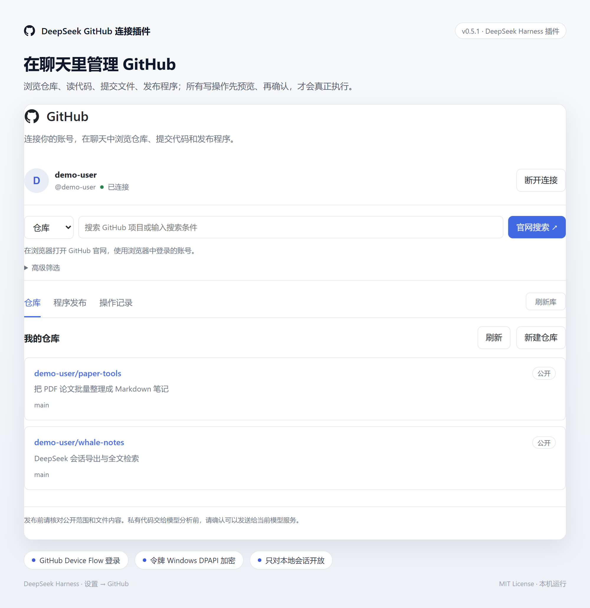
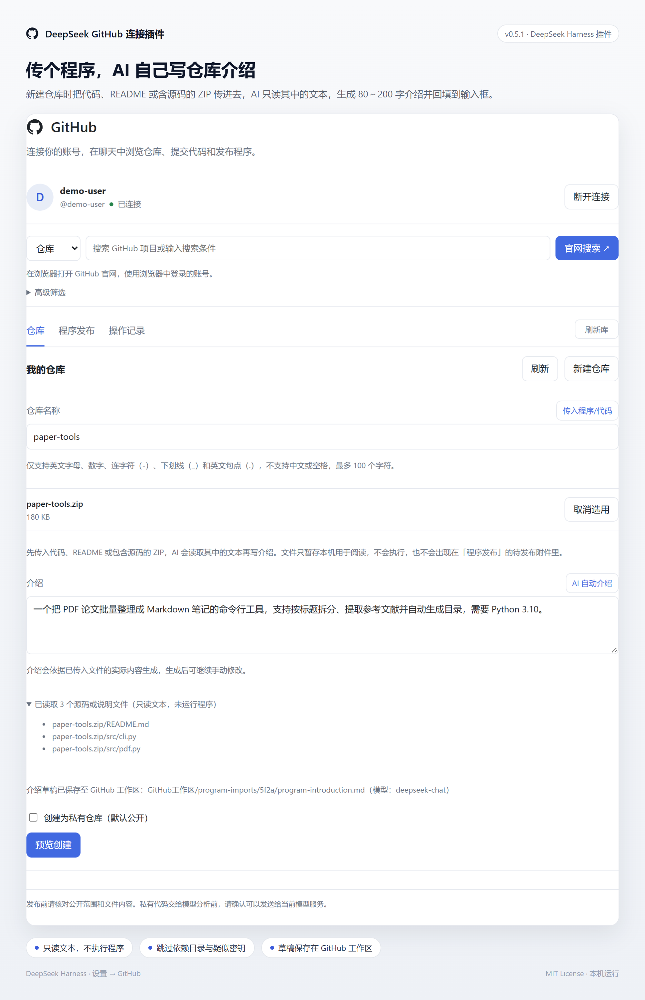
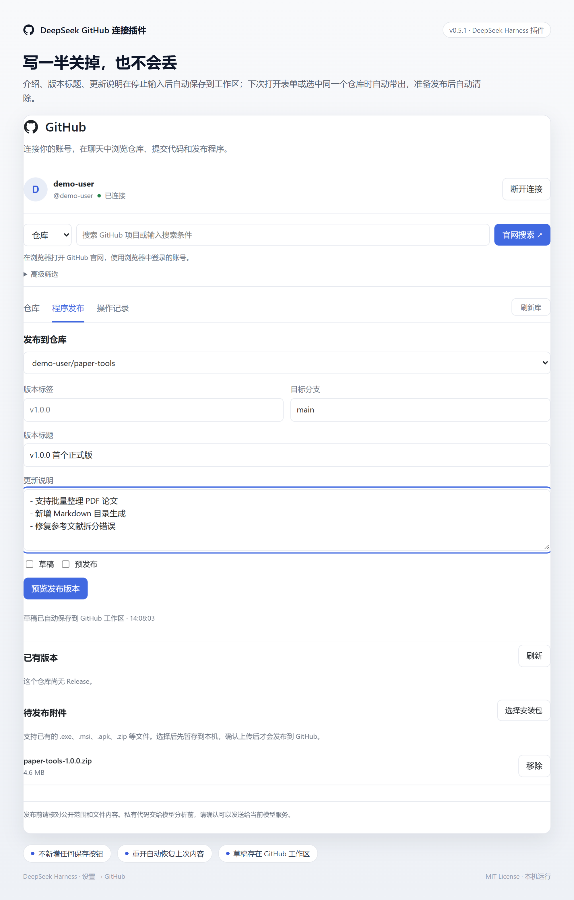

# DeepSeek GitHub Connect

**面向 DeepSeek Harness 的 GitHub 连接与发布插件。** 在聊天中读取项目、准备代码提交，在设置页管理仓库、生成项目介绍并发布程序版本。

> 第三方开源项目，非 DeepSeek 或 GitHub 官方产品。适用于 Windows 上的 DeepSeek Harness；不适用于普通的 `chat.deepseek.com` 聊天网页。



## 项目概述

DeepSeek GitHub Connect 将 GitHub 仓库操作集成到 Harness 的工具调用与设置界面中。它围绕个人开发者的实际流程设计：阅读项目、整理介绍、创建仓库、准备修改，以及向 Release 上传安装包。

仓库读取与官网跳转可以直接进行；创建仓库、提交文件、创建 Release 和上传发布附件先形成操作预览，再由用户确认执行。删除入口仅跳转 GitHub 设置页，最终删除在官网完成。

## 功能一览

| 模块 | 能力 |
| --- | --- |
| GitHub 连接 | OAuth Device Flow 登录；本机 Windows DPAPI 加密保存令牌 |
| 仓库浏览 | 浏览已授权仓库、目录和文本文件，查看版本及附件链接 |
| 聊天工具 | 搜索公开仓库和代码、读取文件、准备建库及提交操作 |
| 官网搜索 | 仓库／代码分类，高级筛选，直接在浏览器打开 GitHub 原生搜索 |
| AI 项目介绍 | 传入源码、README 或源码 ZIP，根据可读文本生成可编辑介绍 |
| 文案草稿 | 新建仓库介绍、Release 标题及更新说明自动保存和恢复 |
| 程序发布 | 创建版本、填写更新说明、选择安装包并确认上传 |
| 操作确认 | 明确显示账号、仓库及待执行内容；失败不盲目重试 |
| 删除入口 | 二次提示后跳转对应仓库的官网设置页 |

## 使用界面

### 传入代码，让 AI 协助撰写项目介绍

在“仓库 → 新建仓库”中，点击仓库名称旁的“传入程序/代码”。文件成功暂存后，“AI 自动介绍”按钮才会启用。AI 读取选中文件中的源码或说明片段，生成介绍并回填；用户可以继续修改，再预览创建仓库。



- 支持常见代码文件、README 和包含源码的 ZIP。
- 不执行安装包，也不根据文件名猜测功能。
- `.exe`、`.msi`、`.apk` 或仅含二进制的压缩包需补充源码或可读说明。
- 用于介绍的导入文件仅暂存在本机，与待发布的安装包分开管理。
- 生成介绍使用 Harness 默认模型与现有模型凭据，会产生对应模型服务的调用用量。

### 文案自动保存，方便继续编辑

新建仓库介绍以及程序发布页的版本标题、更新说明，在停止输入后自动保存到本机 GitHub 工作区。再次打开对应表单时，自动恢复可用草稿；版本文案按仓库保存。



草稿是本机文案备份，不是已经发布的 GitHub 内容。准备创建或发布操作后，会清理相应表单草稿；真正执行仍需到操作预览中确认。暂存安装包不等于已上传到 GitHub。

> 三张图片使用演示账号和示例项目，展示产品操作流程，不表示这些示例项目是本仓库附带的软件。

## 安装

### 环境要求

- Windows；登录凭据保护依赖 Windows DPAPI CurrentUser。
- DeepSeek Harness。开发基线为 `0.2.2-rc.1`，其他版本的插件接口可能存在差异。
- 网络能访问 GitHub 登录页、`api.github.com` 和 `uploads.github.com`。
- 使用 AI 介绍时，需在 Harness 中配置可用默认模型。

### 通过 GitHub 仓库安装

在 Harness 中打开“插件 → 添加插件”，输入本仓库地址：

```text
https://github.com/zhaohaix/DeepSeek-GitHub
```

安装并启用后，进入“设置 → GitHub”。本仓库包含已构建的 `lib/` 文件；使用本地源码目录安装时，请保持目录位置稳定。

### 使用本地源码或安装包

也可以克隆项目后，在“添加插件”中输入本地项目目录。若使用构建好的 `.tgz`，按当前 Harness 插件管理器支持的本地包方式安装；项目附带 Windows 安装脚本，运行前需完全退出客户端。

```sh
git clone https://github.com/zhaohaix/DeepSeek-GitHub.git
cd DeepSeek-GitHub
npm ci
npm run verify
```

## 配置 GitHub 登录

**公开版本没有预置个人 OAuth App Client ID。** 首次登录前需配置自己的 GitHub OAuth App：

1. 在 GitHub 的 **Settings → Developer settings → OAuth Apps** 创建应用。
2. 填写自己的应用名称及主页信息，并在应用设置中启用 **Device Flow**。
3. 将公开的 **Client ID** 填入插件“设置 → GitHub”的登录应用配置。
4. 点击“登录 GitHub”，打开 GitHub 官方设备授权页，输入显示的设备代码并授权。

此流程不要求在插件中填写 Client Secret。不要把访问令牌、Client Secret 或本机配置上传到仓库。

| 配置状态 | 可使用范围 |
| --- | --- |
| 未配置 Client ID、未登录 | 官网搜索和高级筛选可使用浏览器账号；插件内需要认证的仓库与发布流程不可开始使用 |
| 已配置并完成授权 | 在账号与令牌权限内使用仓库、提交和发布功能 |
| 本机已有仍有效的令牌 | 清空预置 Client ID 不会主动撤销令牌；失效或退出后需先配置再登录 |

授权请求使用 `repo` 范围，涉及公开及私有仓库，请核对 GitHub 授权页。插件不申请 `delete_repo`；删除按钮只打开官网。

## 典型操作流程

### 阅读与分析项目

在设置页选择仓库，或在聊天中提供 `owner/repository`、文件路径或 GitHub 链接。例如：

```text
请读取这个仓库的 README，再介绍目录结构和主要模块。
```

搜索返回的是检索线索，建议继续读取原文后再下结论。REST 代码搜索与官网新代码搜索的语法和索引能力并非完全一致。

### 创建仓库

填写仅包含英文字母、数字、连字符、下划线或英文句点的仓库名，手写介绍或传入源码后生成介绍，再选择公开／私有并预览创建。默认公开，请在确认页检查可见性。

### 发布程序

选择自己的仓库，填写版本标签、目标分支、版本标题和更新说明。先预览并确认创建 Release，再选择已暂存的安装包，预览并确认上传。安装包上传与源码编译是两项不同工作，本插件不负责自动编译。

### 跳转官网搜索或删除

搜索框提交后由浏览器打开 GitHub 官网，使用浏览器中的登录账号。删除按钮位于自己的仓库详情，确认后打开该仓库设置页，在官网按提示完成最终删除。

## 隐私与安全边界

- 本机数据默认保存在用户主目录下 `.dsh/github-connect`，包括加密令牌、暂存文件、诊断日志和文案工作区。
- 令牌使用 Windows DPAPI CurrentUser 加密，不通过普通页面状态接口返回。
- 本地 API 限定宿主浏览器身份及本机访问；本项目面向个人桌面环境，不适合作为公开多租户服务。
- ZIP 只读取符合限制的文本，不运行其中的程序；会跳过依赖目录、部分构建产物和明显凭据文件。启发式筛选不能保证发现所有敏感信息。
- AI 将所选文本发送给 Harness 配置的模型服务，生成结果需审阅，不能视为已验证的软件功能或测试结论。
- 若写入后网络中断，请先核实 GitHub 上的实际结果，再决定是否重新准备操作。
- 当前没有自动刷新过期 OAuth 令牌的完整续期流程；应用启用可过期令牌时，可能需要重新登录。

## 常见问题

**是否必须使用网络加速？** 取决于网络能否稳定访问 GitHub 官方地址。插件不提供镜像中转；浏览器和 Harness 后台都需要正常连接。

**为什么安装包传入后仍不能生成介绍？** 二进制文件不能直接提供可靠的功能证据，请补充源码 ZIP、README 或代码文件。

**新建仓库后列表里没有显示？** 点击标签栏右侧的“刷新库”，同步更新仓库列表与发布下拉框。

**插件登录与浏览器登录是否相同？** 两者分别管理。官网搜索和删除跳转使用浏览器账号；插件 API 使用设备授权取得的本机令牌。

**为什么会显示未连接？** 可能是令牌失效、凭据读取失败或网络异常。后台脱敏日志用于区分原因，不应仅凭界面状态判断令牌已被删除。

## 开发与贡献

```sh
npm ci
npm run verify
npm run release:check
npm pack
npm run release:source
```

公开打包检查要求预置 Client ID 为空，并排除个人运行资料、日志、浏览器缓存与凭据。请勿将整个本机开发目录直接上传。欢迎通过 Issue 报告可复现问题；提交截图或日志前请去除个人信息与秘密值。

本项目使用 MIT License。第三方依赖遵循各自许可证；不附带或重新分发 DeepSeek Harness 宿主运行时。
